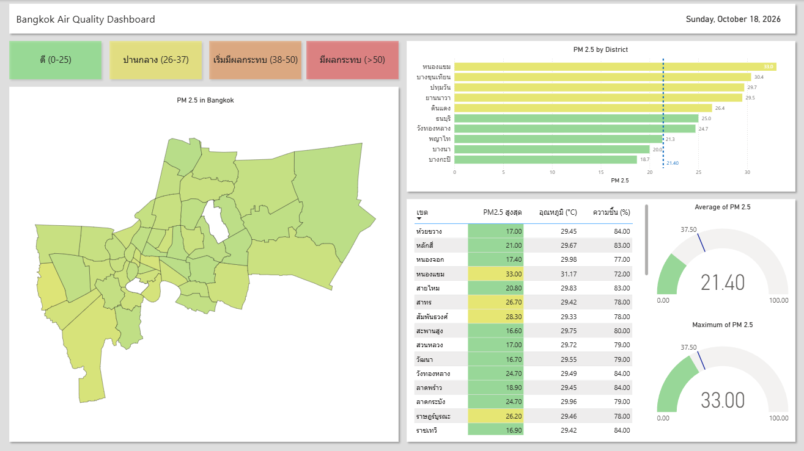

# 🌫️ BKK Air Quality & Weather Intelligence (End-to-End ETL Pipeline)

An End-to-End Data Engineering and Data Analytics project designed to extract PM2.5 air quality and weather data in Bangkok. The pipeline automates data cleaning, transformation, and daily database ingestion, visualizing the insights through an interactive Power BI dashboard.

## 🚀 Project Overview
This system automatically monitors air quality at the district level in Bangkok.
- **Extract:** Retrieve pollution data from the **Air4Thai API** and temperature/humidity data from the **OpenWeatherMap API**.
- **Transform:** Clean data, extract district names, handle missing values (NaN), and prepare the Data Schema using **Pandas**.
- **Load:** Ingest data into a **PostgreSQL** database on **Supabase** using an Upsert mechanism to prevent data duplication (Idempotency).
- **Automate:** Schedule automatic daily runs at 08:00 AM (ICT) via **GitHub Actions**.
- **Visualize:** Connect the database to **Power BI** to build a Geographic Dashboard (Shape Map) and perform Trend Analysis.

## 🛠️ Tech Stack & Tools
- **Language:** Python 3.10
- **Libraries:** `pandas`, `requests`, `supabase`, `python-dotenv`
- **Database:** PostgreSQL (Supabase)
- **Automation:** GitHub Actions (CI/CD)
- **BI Tool:** Power BI Desktop

## 📊 Dashboard Highlights



- **Shape Map Visualization:** Heatmap displaying PM2.5 levels across all 50 districts in Bangkok.
- **Top 10 Critical Zones:** Bar chart ranking the most critical areas with Dynamic Conditional Formatting (automatically turns red when exceeding the safety threshold).
- **Weather Correlation:** Analysis of the relationship between PM2.5, temperature, and humidity.
- **Time Series Trend:** Sparklines showing daily historical PM2.5 trends.

## 📂 Project Structure
```text
bkk_air_quality/
│
├── .github/workflows/
│   └── daily_etl.yml             # Automated schedule script (Cron Job)
│
├── powerbi/
│   ├── air_quality_dashboard.pbix # Power BI Dashboard file
│   └── dash-1.png                 # Dashboard screenshot image
│
├── src/
│   ├── extract.py                # Extract data from APIs (Air4Thai & OpenWeather)
│   ├── transform.py              # Clean data and handle Data Types
│   └── load.py                   # Connect and Upsert data into Supabase
│
├── main.py                       # Main entry point for the ETL Pipeline
├── requirements.txt              # Required Python libraries
├── .env                          # Environment variables (API Keys - Git ignored)
└── .gitignore                    # Files to be ignored by Git
```

## 🗄️ Database Schema (Supabase PostgreSQL)
The bkk_air_quality table is designed for Time Series Data with the following structure:
- id (Primary Key)
- station_id (Station ID)
- station_name (Station Name)
- district_name (District Name)
- latitude / longitude (Coordinates)
- pm25 (PM2.5 value)
- temp / humidity (Temperature and Humidity)
- recorded_at (Last updated timestamp)
- record_date (Data collection date)
### Note: A Unique Constraint is set on station_id + record_date to handle the Upsert process safely without duplicating daily records.

## 🤖 Automation Details
- GitHub Actions is utilized to automate the ETL Pipeline:
Triggered: Scheduled via Cron (0 1 * * * or 08:00 AM ICT daily) and supports manual execution (workflow_dispatch).
Secrets Management: API Keys and Database Credentials are securely stored using GitHub Secrets.